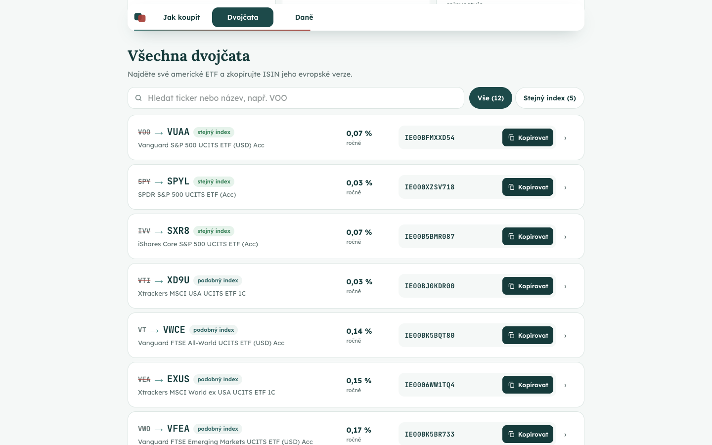

# ETF dvojčata

Na YouTube niekto povie „kúp VOO“. Čech otvorí XTB alebo Trading 212 a fond tam nenájde, lebo americké ETF sa v EÚ drobným investorom predávať nesmú. Táto stránka mu za pár sekúnd ukáže európske „dvojča“, ktoré si kúpiť môže, aj s ISIN na skopírovanie. Za e-mail dostane prehľad všetkých 12 dvojčiat a návod na prvý nákup.

- **Reklama A:** https://etfdvojcata.vercel.app/?ad=twin
- **Reklama B:** https://etfdvojcata.vercel.app/?ad=fees
- **Admin:** https://etfdvojcata.vercel.app/admin (token pošlem zvlášť, lokálne v Dockeri `review-token`)
- **Obe reklamy s textami:** [ads/README.md](ads/README.md)

| Reklama A na mobile | Reklama B na mobile | Prehľad za e-mail | Admin |
|---|---|---|---|
|  |  |  |  |

_Dáta v admine na screenshote sú simulované._

## Pre koho

Čech medzi 25 a 40 rokmi na mobile. Buď už investuje cez aplikáciu (XTB, Trading 212, Revolut) a pozná tickery z YouTube, alebo má peniaze v podielovom fonde z banky a netuší, koľko ho stojí.

Väčšina českých stránok o ETF porovnáva americké fondy, ktoré si čitateľ aj tak nekúpi. Táto dá odpoveď, s ktorou sa dá hneď niečo urobiť: čo kúpiť, kde a za koľko.

V prehľade je 12 ETF, lebo zadanie hovorí o fondoch z NYSE. Populárne QQQ, VXUS a BND sa obchodujú na Nasdaqu, preto som ich vyradil.

## Čo návštevník dostane a kedy chcem e-mail

- **Hneď a zadarmo:** vyhľadávač dvojčiat (vyberie VOO a vidí VUAA, poplatok, burzu a ISIN) a kalkulačku, ktorá ukáže, koľko ho stojí fond z banky oproti ETF.
- **Za e-mail:** prehľad všetkých 12 dvojčiat s ISIN, návod na nákup v troch krokoch a dane v Česku zrozumiteľne.
- **Kedy sa pýtam:** až keď už niečo dostal. Tlačidlo je hneď pod výsledkom vyhľadávača aj kalkulačky. Tlačidlo „Přehled zdarma“ je stále v hlavičke, aj keď človek scrolluje.
- **Formulár:** jedno pole, e-mail.
- **Po odoslaní:** prehľad sa hneď odomkne na stránke. Potom jedna nepovinná otázka („koľko mesačne investujete?“), nepovinná ponuka „pomôžeme s prvým nákupom, zavoláme vám“ a tri krátke e-maily počas deviatich dní.

## Dve reklamy

| | A – Dvojča | B – Poplatky |
|---|---|---|
| Komu | Kto už investuje a nenašiel VOO v aplikácii | Kto má peniaze vo fonde z banky |
| Prísľub | „VOO si v Česku nekoupíte. Jeho dvojče ano.“ | „Fond z banky vs. ETF: 429 100 Kč rozdíl“ |
| Prvá obrazovka | Vyhľadávač s predvoleným VOO, hneď vidno VUAA a ISIN | Kalkulačka s rovnakými číslami ako v reklame (3 000 Kč mesačne, 20 rokov) |

Prvá obrazovka teda opakuje presne to, čo reklama sľúbila. Druhý nástroj je na stránke nižšie, pre tých, ktorých oslovil iný uhol.

## Poradie sekcií

1. **Sľub reklamy a jeden nástroj.** Návštevník z reklamy dá stránke pár sekúnd, preto hneď dostane to, kvôli čomu klikol, bez prepínania.
2. **Prečo nám veriť:** štyri čísla a tri záruky, napríklad že každý údaj má zdroj. Vymyslené referencie nepoužívam.
3. **Druhý nástroj** pre tých, na ktorých neplatil prvý uhol.
4. **Ako to funguje v troch krokoch:** nájdi dvojča, skopíruj ISIN, kúp v aplikácii.
5. **Ukážka prehľadu s formulárom:** päť riadkov tabuľky, z toho dva rozmazané, a pod nimi pole na e-mail.
6. **Časté otázky:** prečo VOO v aplikácii nie je, dane, kde kúpiť.
7. **Záverečná výzva.** Kto dočítal až sem, má námietky vyriešené, preto stránka končí formulárom.

Všetko, čo nepomáhalo získať kontakt, som vyhodil: prepínač nástrojov, veľké karty dôvery a navigáciu, ktorá by viedla preč. Na mobile má stránka asi päť obrazoviek.

## Dáta

- **12 dvojíc** amerických ETF a ich európskych verzií, údaje k 22. 10. 2026. Pri každej je zdroj a dátum: stránky emitentov (Vanguard, iShares, SSGA) a justETF. Súbor: [packages/shared/data/etfs.json](packages/shared/data/etfs.json).
- **Fond z banky v kalkulačke** je ČSOB Akciový podľa oficiálneho dokumentu KID: vstupný poplatok 3 % a 2,59 % ročne.
- **Kontrola:** samostatný agent znovu otvoril všetky zdroje a porovnal 130 údajov. Všetkých 130 sedelo.

## Meranie

Meria sa každý krok od príchodu po odoslanie formulára: návšteva, použitie nástroja, klik na tlačidlo, otvorenie formulára, začatie písania a lead. Všetko je zvlášť pre reklamu A a B a podľa kreatívy. Lead potvrdzuje server, takže sa nedá podvrhnúť z prehliadača.

V admine je celý lievik, porovnanie A a B s výpočtom, či je rozdiel štatisticky významný, a cena za lead, keď zadáte útratu za reklamu. Pri každom leade je jeho celá cesta po stránke.

## Očakávaná konverzia

| Krok | Odhad |
|---|---|
| Použije nástroj | 45 – 60 % návštevníkov |
| Klikne na tlačidlo | 20 – 30 % |
| Odošle e-mail (z tých, čo klikli) | 45 – 60 % |
| **Z návštevy lead** | **10 – 15 %, realisticky okolo 12 %** |

Je to môj odhad po krokoch, nie overený benchmark. Reklama B bude mať podľa mňa menej leadov, ale kvalitnejších, lebo oslovuje ľudí s peniazmi vo fonde. Skutočné čísla budú po zhruba 1 000 návštevách na variant.

## Tri A/B testy (od najväčšieho dopadu)

1. **Pole na e-mail priamo pod výsledkom** namiesto tlačidla, ktoré otvára formulár. Na mobile ubudne jeden krok. Čakám +20 až 30 % leadov.
2. **Iný názov odmeny:** „Prehľad 12 dvojčiat“ oproti „Návod: prvé ETF za 15 minút“. Návod môže osloviť viac začiatočníkov. Čakám ±15 % a iný typ leadov.
3. **Ponuka hovoru hneď po odoslaní** oproti ponuke až v poslednom e-maile. Ovplyvní, koľko ľudí odovzdáme na telefonát, nie počet leadov. Čakám ±30 %.

## Ako som pracoval s AI

Pracoval som v Claude Code. Vždy najprv plán ([PLAN.md](PLAN.md)), potom kód po malých krokoch s commitmi a nakoniec kontrola. Stránku som prechádzal ako návštevník na mobile a posielal Claudovi screenshoty s krátkou spätnou väzbou, napríklad „príliš veľa textu“ alebo „toto užívateľ nepochopí“.

**Pokyny pre agentov.** Výskum dát, kontrolu dát a kontrolu kódu robili samostatní agenti. Zadania im napísal Claude na môj pokyn. Hlavné pravidlá boli:
- pri každom čísle zdroj a dátum, a radšej prázdne pole než odhad,
- kontrolór má byť skeptický a hľadať chyby,
- kontrola kódu iba hlási problémy, nič sama neopravuje.

**Ako som kontroloval výstup:**
- automatické testy,
- test celej cesty návštevníka v prehliadači,
- screenshoty mobilu a desktopu po každej zmene,
- Lighthouse (výkon 99, ostatné 100),
- nezávislé kontroly kódu a bezpečnosti agentom, ktorý nevidel našu konverzáciu.

**Kde sa AI pomýlila (výber):**
- Ako riešenie dĺžky stránky navrhla prepínač dvoch nástrojov. Namietol som, že ho človek z reklamy za pár sekúnd prehliadne. Rozdelili sme ich do dvoch sekcií.
- Navigáciu v prehľade „opravila“ bez overenia a chyba zostala. Odhalil to až automatický test klikov, ktorý je teraz súčasťou testov.
- Po odomknutí sa tlačidlo „Otevřít přehled“ opakovalo šesťkrát. Všimol som si to ja, test to potvrdil.
- Výskumný agent označil fond ako „rovnaký index“, hoci v poznámke sám napísal, že index je iný.
- Na Verceli API po nasadení padalo, hoci lokálne fungovalo. Claude chybu našiel v logoch a opravil.

Kľúčové prompty doslovne, s odkazom na commit, ktorý z nich vznikol: [ai-log/prompts.md](ai-log/prompts.md). Všetky chyby a výsledky kontrol po kolách: [docs/ai-workflow.md](docs/ai-workflow.md). Export konverzácií: [ai-log/](ai-log/README.md).

## Čo chýba pred ostrou kampaňou

- **Odosielanie e-mailov:** je hotové, chýba len overená odosielacia doména (Resend). Kým nie je, prehľad sa ukáže iba na stránke.
- **Právne veci:** doplniť prevádzkovateľa na stránke o ochrane údajov a nechať posúdiť súhlasy aj porovnanie s konkrétnym fondom v reklame B.
- **Ochrana proti botom:** captcha pred väčším rozpočtom. Teraz chráni skryté pole pre boty, kontrola pôvodu formulára a denný limit na IP.
- **Aktualizácia dát:** údaje sú k 22. 10. 2026. V produkcii by ich mal raz mesačne overiť agent.
- **Prehľad je zamknutý len mäkko:** kto pozná adresu `/report`, otvorí ho aj bez e-mailu.

Úplný zoznam: [docs/technical.md](docs/technical.md#úplný-zoznam-toho-čo-chýba-pred-kampaňou).

## Spustenie

```bash
docker compose up --build                          # web a admin na http://localhost:3000 (token review-token)
docker compose --profile demo run --rm demo-data   # voliteľne simulované návštevy, aby admin nebol prázdny
```

Netreba Node ani žiadne účty. Spustí sa databáza Postgres, API v NestJS a web v Next.js.

Technické detaily (architektúra, meranie udalostí, bezpečnosť, príkazy pre vývoj): [docs/technical.md](docs/technical.md) a [SECURITY.md](SECURITY.md).
