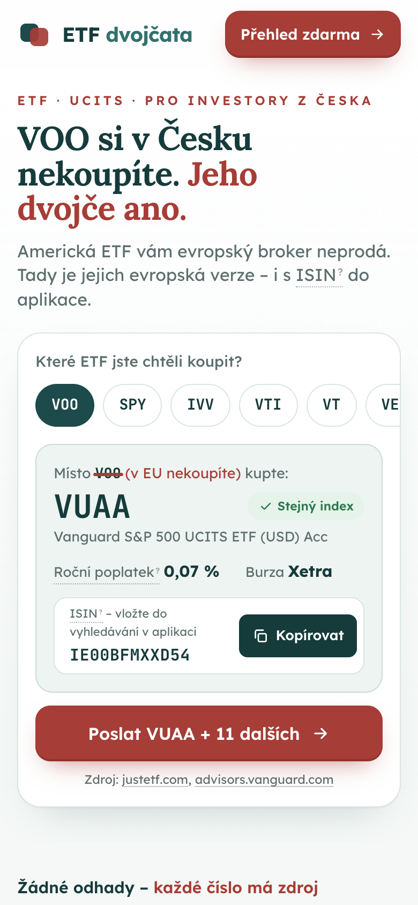
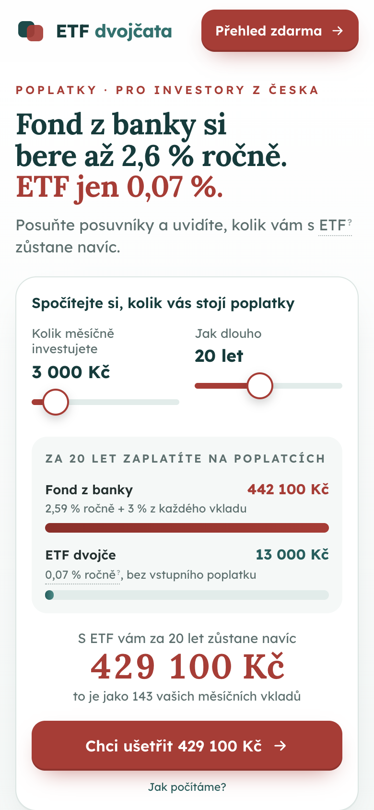
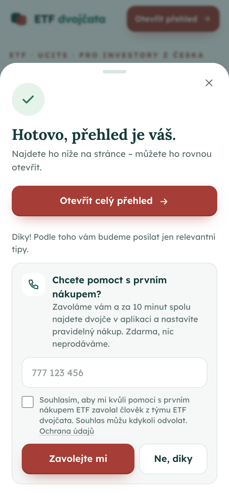
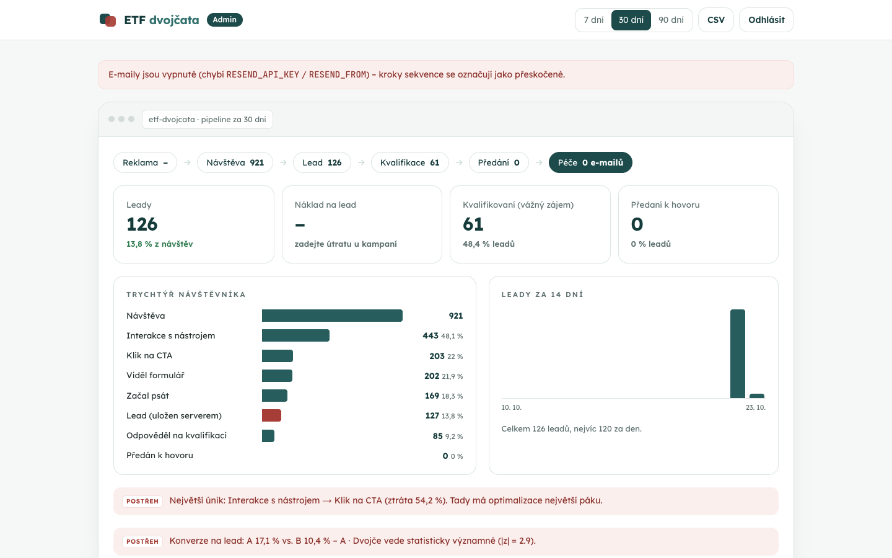

# ETF dvojčatá – konverzná landing page s lead pipeline (zadanie B)

Landing page pre českého drobného investora, ktorý prichádza z reklamy na mobile. Ukáže mu **európske (UCITS) „dvojčatá“ 12 ETF z NYSE Arca**, ktoré si v ČR naozaj kúpi, a spočíta, koľko ho stojí fond z banky. Výmenou za e-mail odomkne celý prehľad. Po odoslaní nasleduje kvalifikácia, voliteľné odovzdanie na telefonát a e-mailová starostlivosť. Celý lievik je viditeľný v admin dashboarde.

- **Stránka:** _doplniť URL po nasadení_ · varianty reklamy: `/?ad=twin`, `/?ad=fees`
- **Admin (pipeline):** `/admin` (token pošlem zvlášť)
- **Reklamy:** [ads/README.md](ads/README.md) – 2 verzie, texty, UTM odkazy
- **Dáta so zdrojom pri každom údaji:** [data/etfs.json](data/etfs.json)
- **Plán:** [PLAN.md](PLAN.md) (v1 + v2) · **Export konverzácií s Claude Code:** [ai-log/](ai-log/)

### Spustenie pre review (Docker, bez Node aj bez účtov)

```bash
docker compose up --build                           # web: http://localhost:3000  ·  admin: http://localhost:3000/admin (token: review)
docker compose --profile demo run --rm demo-data    # voliteľne: 400 simulovaných návštev, aby dashboard nebol prázdny
```

Databáza je PGlite (Postgres vo WASM) v Docker volume, takže dáta prežijú reštart. E-maily sa bez `RESEND_API_KEY` iba označia ako preskočené. Iný port: `PORT=8080 docker compose up --build`. Zmazanie dát: `docker compose down -v`.

| Mobil – varianta A | Mobil – varianta B | Po odoslaní | Admin |
|---|---|---|---|
|  |  |  |  |

_Dáta v adminu na screenshote sú simulované (`scripts/simulate.mjs` cez skutočné API, lokálne PGlite)._

---

## 1. Kľúčová myšlienka

Český investor vidí na YouTube a Reddite „kúp VOO“, otvorí XTB alebo Trading 212 a fond tam nenájde. Dôvodom je regulácia PRIIPs: fond predávaný retailu v EÚ musí mať dokument KID a americké ETF ho nemajú. Riešením je európska verzia (UCITS) so **rovnakým indexom**, ktorú si kúpi.

Väčšina českých stránok o ETF porovnáva americké fondy, ktoré si čitateľ nekúpi. Táto stránka dá použiteľnú odpoveď hneď po prvom ťuknutí: ticker, ISIN na skopírovanie, poplatok a burzu.

**Prečo len 12 ETF:** zadanie hovorí o ETF obchodovaných na NYSE. Agent zistil, že QQQ, VXUS a BND sú na Nasdaqu, preto som ich vyradil. Výnimku pre populárne QQQ som zvážil, ale držal som sa zadania.

## 2. Cieľová skupina, hodnota, moment žiadosti

| | |
|---|---|
| **Kto** | Čech 25 – 40 rokov na mobile. Už investuje alebo začína cez XTB, Trading 212 či Revolut, prípadne má peniaze v podielovom fonde z banky. Z YouTube pozná tickery, ale nevie, prečo ich nenájde v aplikácii. |
| **Hodnota zadarmo** | Vyhľadávač dvojčiat (12 ETF → UCITS verzia + ISIN + TER + zdroj) a kalkulačka poplatkov (fond z banky vs. ETF). Celú hodnotu vidí ešte pred formulárom. Neznáme pojmy (UCITS, TER, ISIN, KID, PRIIPs) vysvetľuje slovníček priamo v texte. |
| **Za e-mail** | Prehľad všetkých 12 dvojčiat na jednej stránke (ISIN, typ, rozdiely v indexe, alternatívy), návod na nákup a daňové pravidlá v ČR. |
| **Kedy žiadame** | Až po prvej interakcii: tlačidlo je priamo pod výsledkom vyhľadávača aj kalkulačky. Druhá príležitosť je náhľad tabuľky s rozmazanými riadkami, tretia záverečné CTA. Na mobile je k dispozícii lepkavé CTA, ktoré sa schová, keď je na obrazovke iná výzva. |
| **Formulár** | **1 pole (e-mail)** v bottom sheete, fokus rovno v poli, `inputmode=email`. Súhlas je jedna veta pod tlačidlom. Proti botom chráni honeypot namiesto captchy. |
| **Po odoslaní** | (1) prehľad sa hneď odomkne na stránke a príde e-mailom, (2) **nepovinná kvalifikačná otázka** „kolik měsíčně investujete?“ (1 ťuk), (3) **nepovinná ponuka „pomůžeme s prvním nákupem, zavoláme vám“** – telefón + výslovný súhlas → odovzdanie do CRM / call centra, (4) e-mailová sekvencia D2/D5/D9. |

## 3. Poradie sekcií a prečo

1. **Hero = sľub reklamy + funkčný nástroj.** Návštevník strávi na stránke pár sekúnd, preto prvá obrazovka nadpisom opakuje reklamu (message match) a **hneď pod ním ukazuje výsledok** (VOO → VUAA). Obe varianty sú staticky predrenderované a `proxy.ts` podľa `?ad=` vyberie správnu, takže stránka nebliká.
   - `ad=twin`: „VOO si v Česku nekoupíte. Jeho dvojče ano.“ + vyhľadávač
   - `ad=fees`: „Fond z banky si bere až 2,6 % ročně. ETF jen 0,07 %.“ + kalkulačka
2. **Čísla (4 karty).** 12 dvojčiat, 5 s rovnakým indexom, TER od 0,03 %, 100 % údajov so zdrojom. Rýchly dôkaz pre toho, kto len skroluje.
3. **Druhý nástroj** (kalkulačka alebo vyhľadávač podľa varianty) v tmavej sekcii. Kto nereagoval na prvý uhol, dostane druhý.
4. **Náhľad lead magnetu + formulár.** Konkrétne ukazuje, čo návštevník dostane: tri riadky sú čitateľné, ďalšie rozmazané.
5. **Prečo to nejde kúpiť (PRIIPs).** Buduje dôveru u skeptikov. Je až za formulárom, lebo kto stránke verí, nemusí to čítať.
6. **Karty dôvery** namiesto referencií: nie sme broker, každé číslo má zdroj, čo sa stane s e-mailom, GDPR. Referencie by pri novom produkte boli vymyslené.
7. **FAQ** (dane, rozdiel medzi dvojčatami, kde kúpiť, čo s e-mailom) vrátane zdrojov.
8. **Záverečné CTA** a **pätička** s upozornením a všetkými zdrojmi s dátumom.

Navigácia ani odkazy, ktoré by viedli preč, na stránke nie sú. Jediný cieľ je kontakt.

**Dizajn** vychádza z vizuálneho jazyka clientelo.cz: serifové nadpisy (Lora) + Lexend, tmavá petrolejová a tehlová, eyebrow nadpisy s rozšíreným prestrihom, ikony v tónovaných štvorcoch, nástroje v rámčeku „okna aplikácie“, slovníček s otáznikom pri pojme a reťazec krokov ako v ukážke dashboardu. Značka zostáva vlastná („ETF dvojčata“). Stránka by tak zapadla do portfólia Clientela, a pritom sa za Clientelo nevydáva.

## 4. Stack a architektúra

| Vrstva | Voľba | Prečo |
|---|---|---|
| Front-end | **Next.js 16 (App Router), React 19, TypeScript** | Obe varianty sú staticky predrenderované (rýchle LCP na mobile), interaktívne časti sú klientske „ostrovčeky“ |
| Štýly | **Tailwind CSS 4**, tokeny v `@theme` | Farby, písma a rádiusy na jednom mieste ([app/globals.css](app/globals.css)) |
| Varianty | **`proxy.ts`** (v Next 16 nahrádza middleware) | `/?ad=fees` → interný rewrite na `/v/fees`, varianta sa drží v cookie |
| Databáza | **Postgres + Drizzle ORM** – Neon v produkcii, **PGlite** (Postgres vo WASM) lokálne | Lokálne beží bez účtov aj bez nastavovania, v produkcii stačí `DATABASE_URL`. Migrácie generuje `drizzle-kit` |
| E-maily | **Resend** + **Vercel Cron** (denne) | Okamžitý e-mail + sekvencia, one-click odhlásenie (RFC 8058) |
| Validácia | **Zod** na všetkých API vstupoch | |
| Beh | **Docker** (standalone Next.js server + PGlite vo volume) alebo **Vercel** (Neon + Cron) | Reviewer spustí všetko jedným príkazom |
| Testy | **Vitest** (35 unit testov) + **Puppeteer E2E** | E2E prejde celú cestu v oboch variantoch až po žiadosť o hovor a overí lievik aj export |

```
Reklama (Meta, ?ad=twin|fees + UTM)
  └─ proxy.ts ─ rewrite → /v/twin | /v/fees (statické HTML)
       └─ prehliadač: track() ──sendBeacon──▶ /api/track ──▶ events
          formulár ─────────────────────────▶ /api/lead  ──▶ leads + email_jobs ──▶ Resend (D0)
          kvalifikácia ─────────────────────▶ /api/qualify ─▶ rescore
          telefón + súhlas ─────────────────▶ /api/call ───▶ rescore ──▶ HANDOFF_WEBHOOK_URL (CRM / call centrum)
Vercel Cron (denne) ──▶ /api/cron/emails ──▶ splatné kroky D2/D5/D9 ──▶ Resend
Klik v e-maile ──▶ /api/r (meria klik, presmeruje len v rámci webu) ──▶ rescore
/admin ──▶ lievik, A/B, kampane + CPL, sekvencia, leady, cesta relácie, CSV
```

## 5. Lead pipeline (podľa lievika Clientela)

`Reklama → Návštěva → Lead → Kvalifikace → Předání → Péče`

| Fáza | Čo sa deje | Kde |
|---|---|---|
| **Návštěva** | Udalosti bez cookies (anonymné ID relácie v `sessionStorage`): príchod, interakcia, CTA, formulár… | `events` |
| **Lead** | E-mail → upsert (opakované odoslanie neprepíše pôvodný zdroj), naplánovanie sekvencie, okamžitý e-mail | `leads`, `email_jobs` |
| **Kvalifikace** | Skóre z odpovede a zo správania. Hranica pre „kvalifikovaný“ je 35 bodov | [lib/pipeline/score.ts](lib/pipeline/score.ts) |
| **Předání** | Iba s **telefónom a výslovným súhlasom**: webhook do CRM. Bez webhooku je lead vo fronte a v adminu sa dá odovzdať ručne | [lib/server/pipeline.ts](lib/server/pipeline.ts) |
| **Péče** | D0 prehľad · D2 ako kúpiť · D5 dane · D9 „už máte prvé ETF?“ + ponuka pomoci (→ späť do odovzdania) | [lib/server/email.ts](lib/server/email.ts) |

**Skóre leadu:** e-mail +10 · investuje do 2 tis. +10 / 2 – 10 tis. +25 / nad 10 tis. +40 · počítal poplatky +5 · skopíroval ISIN +10 · otvoril prehľad +5 · klikol v e-maile +10 · chce hovor +30. Dashboard pri každom leade ukazuje rozpis, takže obchodník vidí, prečo je lead „horúci“.

**Admin** (`/admin`, `ADMIN_TOKEN`): pipeline s počtami, KPI (leady, **náklad na lead** z útraty zadanej ku kreatíve, kvalifikovaní, odovzdaní), lievik návštevníka, leady za 14 dní, tabuľka A/B, kampane podľa `utm_content`, štatistiky sekvencie, posledné leady, detail leadu s celou cestou relácie, náhľad e-mailov a CSV export. Postrehy počíta jednoduché pravidlo, nie LLM: najväčší únik pred leadom a z-test konverzie A vs. B.

## 6. Dáta a zdroje

- **12 párov US ETF → UCITS dvojča**, údaje k 22. 10. 2026. Pri každom páre je `source_url` a dátum. Americké fondy sú overené na stránkach emitentov (Vanguard, iShares, SSGA), UCITS fondy na justETF a SSGA. Pri SCHD blokoval web Schwab automatický prístup, preto je zdrojom stockanalysis.com (v dátach je to poznamenané).
- **5 dvojčiat má rovnaký index** (VOO, SPY, IVV, IWM, GLD). Ostatné sú najbližšie alternatívy a stránka vždy uvádza, v čom sa líšia.
- **Fond z banky v kalkulačke:** ČSOB Akciový podľa KID k 1. 6. 2026: vstupný poplatok 3 %, priebežné náklady 2,59 % ročne. Transakčné náklady 0,39 % zámerne nepočítam, aby porovnanie nebolo nadsadené.
- **České pravidlá:** PRIIPs (nariadenie 1286/2014), MiFID II (profesionálny klient), zákon o daniach z príjmov § 4 ods. 1 písm. t) a u), zrušenie stropu 40 mil. Kč od roku 2026, zmluva USA–ČR (15 % z dividend).
- **Overenie:** tretí agent nezávisle znovu načítal zdroje a skontroloval všetkých 12 párov: **130 zo 130 polí bolo správnych**. Obmedzenie: kontroloval tie isté URL, nie druhý nezávislý zdroj.

## 7. Meranie celej cesty

| Krok lievika (dashboard) | Udalosti |
|---|---|
| Návštěva (+ UTM, variant, zariadenie) | `page_view` |
| Interakce s nástrojem | `finder_select`, `calc_change`, `isin_copy` |
| Klik na CTA | `cta_click` (zdroj: finder / calc / sticky / header) |
| Viděl formulář → Začal psát | `form_view` → `form_start` (+ `form_error`, `form_submit`) |
| **Lead** | `lead_ok` – zapisuje **server**, z prehliadača sa nedá podvrhnúť |
| Kvalifikace → Předání | `qualify` → `call_request` → `handoff` (server) |
| Péče | `email_click`, `unsubscribe` (server), stavy v `email_jobs` |
| Ostatné | `scroll` 25/50/75/100, `faq_open`, `term_open`, `sticky_view`, `report_open/view` |

Lievik počíta **unikátne relácie** v každom kroku, zvlášť pre každú variantu. Pri leade sa ukladá zdroj, UTM, variant, ticker, o ktorý mal záujem, a suma z kalkulačky. Voliteľne sa dá pripojiť PostHog (`NEXT_PUBLIC_POSTHOG_KEY`, bez cookies) kvôli heatmapám a záznamom relácií.

## 8. Očakávaná konverzia

Odhad pre studenú návštevnosť z Mety na mobile:

| Krok | Odhad | Prečo |
|---|---|---|
| Interakcia s nástrojom | 45 – 60 % | Nástroj je v prvej obrazovke a stačí jeden ťuk |
| Klik na CTA | 20 – 30 % | CTA je hneď pod výsledkom, lepkavé tlačidlo je stále po ruke |
| Odoslanie formulára (z tých, čo klikli) | 45 – 60 % | 1 pole, fokus v poli, hodnotu už pozná |
| **Návšteva → lead** | **≈ 10 – 15 %** (realisticky okolo 12 %) | |
| Lead → kvalifikovaný (≥ 35 bodov) | 25 – 40 % | Varianta B viac (ľudia s peniazmi v bankovom fonde) |
| Lead → žiadosť o hovor | 5 – 15 % | Nepovinné, až po získaní hodnoty |

Odhad vychádza z mojej úvahy o jednotlivých krokoch, nie z overeného benchmarku. Varianta B (poplatky) bude mať podľa mňa nižšiu konverziu na lead, ale kvalitnejšie leady, ktoré sú pre klientov Clientela hodnotnejšie. Preto dashboard ukazuje okrem konverzie aj podiel kvalifikovaných a náklad na lead podľa kreatívy. Skutočné čísla budú po prvých zhruba 1 000 návštevách na variant.

## 9. Tri hypotézy na A/B test (podľa očakávaného dopadu)

1. **E-mailové pole priamo v karte dvojčaťa namiesto tlačidla, ktoré otvára bottom sheet.** Ubudne jeden krok (klik → sheet), čo je na mobile najväčší únik. *Očakávanie:* +20 – 30 % relatívne na návšteva → lead. *Riziko:* stránka pôsobí ako brána ešte pred ochutnávkou. *Metrika:* `lead / visit`.
2. **Formulácia lead magnetu: „přehled 12 dvojčat“ vs. „Návod: první ETF za 15 minut (PDF)“.** Prehľad osloví toho, kto už vie, čo chce. Návod osloví začiatočníkov, ktorých je na Mete viac. *Očakávanie:* ±15 %, mení sa aj profil leadov. *Metriky:* `lead / cta` a podiel kvalifikovaných.
3. **Ponuka hovoru hneď v kroku „hotovo“ vs. až v e-maile D9.** Skoršia ponuka zachytí najviac motivovaných, neskoršia nepôsobí dotieravo a príde po troch hodnotných e-mailoch. *Očakávanie:* ±30 % na počet odovzdaných leadov, bez vplyvu na samotný lead. *Metrika:* `handoff / lead`.

Varianty `twin` vs. `fees` sú test na úrovni reklamy, preto ich medzi hypotézy stránky nepočítam. Infraštruktúra (parameter `ad=`, lievik a skóre podľa variantu, z-test v dashboarde) je na ne pripravená.

## 10. Ako som pracoval s AI

Pracoval som v Claude Code v dvoch kolách. Vždy platilo: **najprv plán** ([PLAN.md](PLAN.md)), potom implementácia po krokoch s commitmi a nakoniec kontroly (unit testy, E2E v prehliadači, screenshoty, nezávislý review agent).

### Kolo 1 – statická stránka (Vite)

| Agent | Zadanie (skrátene) | Ako som kontroloval výstup |
|---|---|---|
| **Výskum US ETF** | 15 ETF: TER, burza, index, AUM, *zdroj a dátum pri každej hodnote*, primárne weby emitentov, „null namiesto odhadu“, na konci zoznam neoverených vecí | Krížová kontrola tretím agentom, ručná kontrola niekoľkých hodnôt |
| **Výskum UCITS dvojčiat** | Ku každému US ETF UCITS ekvivalent: ISIN, tickery, TER, Acc/Dist, veľkosť, „exact/close“ s vysvetlením | To isté + kontrola logiky „exact“ (musí byť doslova rovnaký index) |
| **Výskum ČR** | PRIIPs, dane (paragrafy), poplatky bankových fondov z KID, dostupnosť u brokerov, *pri každom tvrdení zdroj a istota* | Na stránku išli len tvrdenia s vysokou istotou |
| **Nezávislý kontrolór** | „Buď skeptický, hľadaj chyby“: znovu načítať zdroje, vrátiť OK / WRONG / UNVERIFIABLE | Výsledok 130/130 |
| **Code review** | Bugy v API, formulároch, trackingu, prístupnosti; iba report | 14 nálezov, 13 opravených |

### Kolo 2 – stack, pipeline, dizajn

Po prvej verzii som dal spätnú väzbu: stránka má mať skutočný stack a dizajn má byť bližšie ku Clientelu (poslal som screenshoty clientelo.cz). Claude najprv položil otázku, čo myslím „stackom“ (tech stack vs. lead pipeline). Odpovedal som „oboje“. Potom doplnil plán v2 a postupoval v commitoch: backend pipeline → stránka v Reacte → admin → reklamy → review.

- **Overovanie:** po každom kroku `tsc`, unit testy, `curl` na API (vrátane pokusov o open redirect, chybného JSON-u a telefónu bez súhlasu) a screenshoty mobilu aj desktopu, ktoré si Claude sám prezeral. E2E test prejde v prehliadači celú cestu oboch variantov a nakoniec cez admin API overí lievik aj uložený lead.
- **Dokumentácia namiesto pamäti:** Next.js 16 má zmeny (middleware → `proxy.ts`, Turbopack), preto Claude pred písaním kódu čítal dokumentáciu priamo v `node_modules/next/dist/docs`.
- **Grafy v dashboarde:** farby variantov A/B overil validátor palety (CVD ΔE 15,6, kontrast ≥ 3:1). Pôvodná dvojica petrolejová/tehlová neprešla, lebo ju ľudia s protanopiou ťažko rozlíšia.

### Kde sa AI pomýlila (a ako som to zachytil)

**Kolo 1**
- Agent pre UCITS označil VXUS ako „exact“, hoci v poznámke sám napísal, že index je iný.
- Agent pre ČR uviedol neaktuálny TER fondu VWCE (0,22 % namiesto 0,14 %). Rozpor som riešil podľa primárneho zdroja.
- Hlavný agent tvrdil, že strop 40 mil. Kč pri časovom teste platí. Výskumný agent zistil, že pre cenné papiere bol od roku 2026 zrušený.
- Text „XTB ani Trading 212 vám VOO neprodá“ som stiahol, lebo bol overený len u brokera Lynx.

**Kolo 2** (všetko zachytené screenshotmi, testami alebo čítaním výstupu, nie až používateľom)
- **Široké medzery v nadpisoch:** `tabular-nums` na `body` zapol v písme Lora funkciu `tnum`, ktorá nahrádza aj medzeru širokou „číselnou“ medzerou (37 px namiesto 16 px). Claude to najprv hľadal v `text-wrap: balance`, potom zmeral šírku medzery v prehliadači a príčinu našiel. Opravené: `tnum` je len na číslach.
- **Pretečenie na mobile:** riadok tickerov s `overflow-x: auto` roztiahol stĺpec gridu (chýbalo `minmax(0, 1fr)`).
- **PGlite padal** pri prvom dotaze, lebo nevytvorí rodičovský priečinok.
- **Fokus v sheete:** `showModal()` presunul fokus na zatváracie tlačidlo namiesto e-mailového poľa, takže na iOS by sa neotvorila klávesnica. Zachytil to E2E.
- **Ochrana proti CSV injection** pokazila telefónne čísla (`'+420…`). Zachytil to E2E.
- **Zavádzajúci postreh v dashboarde:** „najväčší únik: kvalifikácia → odovzdanie 100 %“. Odovzdanie je nepovinný krok, preto sa únik teraz hľadá len po lead.
- **Texty v rozpore so správaním:** karta dôvery sľubovala „žádné předávání dál“, hoci existuje odovzdanie na hovor (so súhlasom). CTA „Poslat výpočet do e-mailu“ sľubovalo niečo, čo e-mail neobsahuje. Obe opravené.

### Výsledok review (kolo 2)

Review agent dostal kód bez kontextu konverzácie a jediný pokyn: „iba reportuj, nič neupravuj, každý nález over v kóde“. Našiel 13 problémov. Všetky som posúdil ako reálne a opravil som 11. Opravy overujú nové testy (`tests/security.test.ts`), E2E a `curl` proti produkčnému buildu (`next start`).

| Závažnosť | Problém | Oprava |
|---|---|---|
| **Vysoká** | **Open redirect** v `/api/r`: `?to=/%09/evil.com` prešiel kontrolou `startsWith('/')`, lebo URL parser tabulátor zahodí | Cieľ sa parsuje rovnako ako v prehliadači a musí mať náš origin. Test so 7 variantmi útoku |
| **Vysoká** | `/api/lead` bez hlavičky `Origin` (curl) = **relay na posielanie e-mailov** na cudzie adresy. Navyše minie denný limit, takže skutoční ľudia nedostanú prehľad | Mimo `next dev` sa požiadavka bez Originu odmietne. Okamžitý e-mail (D0) a sekvencia majú oddelené denné limity |
| Stredná | Neúspešný e-mail (429/5xx) sa už nikdy nepošle, cron posiela bez odstupov, chýba timeout | Pokusy s počítadlom (max. 3), odstup 550 ms, timeout 8 s |
| Stredná | Migrácie pri prvom requeste cez neon-http (bez transakcie, súbeh pri studenom štarte) | Neon sa migruje pri `npm run build` v transakcii (`scripts/migrate.mjs`), PGlite za behu |
| Stredná | Produkcia bez `DATABASE_URL` by potichu bežala na PGlite v `/tmp` (každá inštancia má vlastnú DB) | V produkcii hlasitá chyba. `SITE_URL` má fallback na produkčnú doménu Vercelu |
| Stredná | Admin a cron bez tokenu boli otvorené na preview deployoch aj pri self-hostingu (`VERCEL_ENV` ≠ production) | Fail closed všade okrem `next dev` |
| Stredná | Opakované odoslanie telefónu = **duplicitný lead v CRM**, neúspešné odovzdanie sa neopakuje | Už odovzdaný lead sa neposiela znovu, webhook má `idempotency_key`, cron opakuje neúspešné odovzdania |
| Nízka | Login do adminu bez limitu pokusov, porovnanie tokenu `!==` | 10 pokusov / 15 min na IP, porovnanie v konštantnom čase |
| Nízka | Text súhlasu posielal klient, takže sa dal podvrhnúť | Klient posiela iba ID verzie (`email_v1`, `call_v1`), server ukladá kanonické znenie ([lib/consent.ts](lib/consent.ts)) |
| Nízka | `/api/track` bez limitu, klient mohol posielať aj `qualify` a `call_request` | 600 udalostí / 10 min na IP. Kvalifikáciu a hovor zapisuje iba server |
| Nízka | Cron a odoslanie formulára mohli poslať ten istý e-mail dvakrát | Job sa pred odoslaním atomicky „zaberie“ (`scheduled → sending`) a odhlásenie sa kontroluje až po zabratí |
| Nízka | Čítačka obrazovky neoznámila nové dvojča (live region sa pri každej zmene vymenil) | Live region zostáva v DOM, tlačidlá tickerov majú `aria-pressed` |

**Vedome neopravené** (v časti 11): captcha / Turnstile proti botom (potrebuje účet, zatiaľ stačí honeypot + Origin + limity) a skenery odkazov v e-mailoch (Outlook Safe Links), ktoré môžu nafúknuť skóre o +10 za „klik“.

## 11. Čo v riešení chýba / pred spustením reklamy

- [ ] **Nasadenie na Vercel** a URL do README.
- [ ] **Env premenné v produkcii:** `DATABASE_URL` (Neon cez Vercel Marketplace), `ADMIN_TOKEN`, `CRON_SECRET`, `SITE_URL`, `RESEND_API_KEY` + `RESEND_FROM` (overená doména), voliteľne `HANDOFF_WEBHOOK_URL`. Bez DB beží produkcia na PGlite v `/tmp`, takže dáta nevydržia reštart.
- [ ] **Právne:** prevádzkovateľ v `/privacy`, kto volá (vlastný tým alebo partner), posúdenie súhlasov, srovnávacia reklama s konkrétnym fondom (reklama B), Meta „special ad category“.
- [ ] **Prehľad je „mäkko“ zamknutý:** `/report` je dostupný aj bez e-mailu (noindex). Kto ho hľadá cez URL, by e-mail aj tak nezadal.
- [ ] **PDF** je zatiaľ „uložiť ako PDF“ cez tlač, nie generovaný súbor.
- [ ] **Dostupnosť u brokerov** je overená iba pre XTB.
- [ ] **Aktualizácia dát:** TER a veľkosti fondov sú snímka k 22. 10. 2026. Pre produkciu by bol potrebný mesačný job s výskumným a kontrolným agentom.
- [ ] **Denný cron** (limit Vercel Hobby): kroky sekvencie odchádzajú raz denne, nie presne na hodinu.
- [ ] **Turnstile / captcha** pred ostrou kampaňou. Teraz chráni honeypot, kontrola Origin a limity na IP.
- [ ] **Skenery odkazov** (Outlook Safe Links) môžu zaznamenať „klik v e-maile“. Riešením je počítať klik až z beaconu na cieľovej stránke.
- [ ] **Double opt-in** e-mailu, ak to bude vyžadovať právny posudok.

## 12. Spustenie

Najrýchlejšie cez Docker (pozri [úvod](#spustenie-pre-review-docker-bez-node-aj-bez-účtov)). Pre vývoj:

```bash
npm install
npm run dev                      # http://localhost:3000 (?ad=twin | ?ad=fees), DB = PGlite v .data/, bez účtov
npm test                         # 35 unit testov (kalkulačka, skóre, sekvencia, telefón, postrehy, bezpečnosť)
npm run e2e -- http://localhost:3000   # celá cesta v prehliadači, oba varianty, lievik + export
ADMIN_TOKEN=review npm run e2e -- http://localhost:3000   # to isté proti Docker kontajneru
node scripts/simulate.mjs http://localhost:3000 400   # simulovaná návštevnosť do lokálneho dashboardu
npm run ads                      # vyrenderuje reklamy a OG obrázok
npm run build                    # migrácia Neon (ak je DATABASE_URL) + produkčný build
node scripts/readme-shots.mjs http://localhost:3000 <ADMIN_TOKEN>   # screenshoty do README
```

**Štruktúra:** `app/` (stránky, `api/` route handlery, `admin/`) · `components/landing`, `components/admin` · `lib/` (`db/` schéma a migrácie, `server/` pipeline, e-maily, štatistiky, `pipeline/` čisté pravidlá skóre a sekvencie) · `proxy.ts` · `data/etfs.json` · `ads/` · `scripts/` · `tests/`
