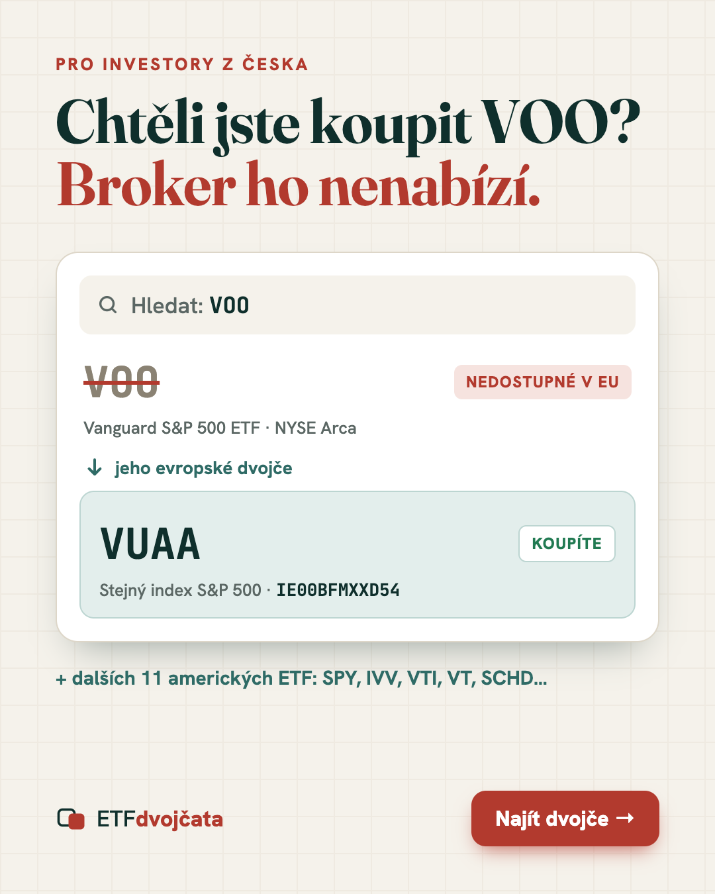
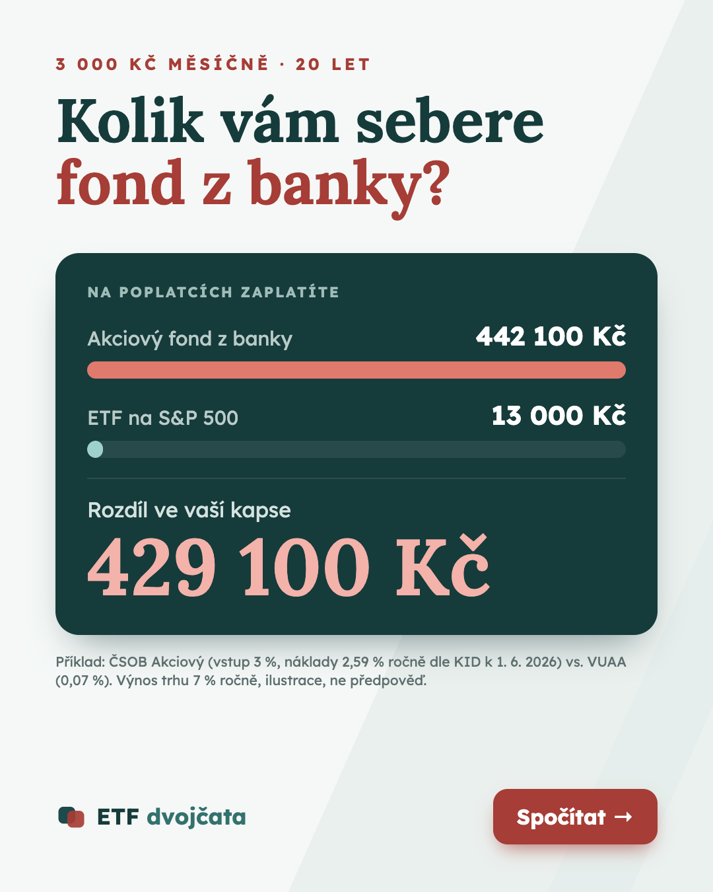

# Reklamy – 2 verze (Meta: Instagram + Facebook feed, mobil)

Formát kreativy: **1080 × 1350 px (4:5)**. Zdrojové HTML je v `ad-*.html` a PNG se generují příkazem `npm run ads`.
Každá verze vede na jinou variantu první obrazovky, takže hero stránky přesně navazuje na slib reklamy.

| | **A – „Dvojče“ (problém → řešení)** | **B – „Poplatky“ (peníze)** |
|---|---|---|
| Kreativa |  |  |
| Úhel | Frustrace: „chtěl jsem koupit VOO a v aplikaci není“ | Ztráta: konkrétní částka, kterou si bere fond z banky |
| Pro koho | Už investuje nebo začíná u XTB / Trading 212 a zná tickery z YouTube/Redditu | Má peníze v podílovém fondu v bance nebo o něm uvažuje |
| Primární text | Chtěli jste koupit VOO nebo SPY a broker je nenabízí? Není to chyba aplikace – americká ETF v EU drobným investorům prodat nesmí. Ukážeme vám evropské dvojče se stejným indexem, ISIN a poplatky. Za 5 vteřin, zdarma. | Akciový fond z banky si bere až 2,6 % ročně + 3 % z každého vkladu. ETF na stejný trh stojí 0,07 %. Při 3 000 Kč měsíčně je to za 20 let rozdíl přes 400 000 Kč. Spočítejte si to pro sebe. |
| Nadpis | VOO si v Česku nekoupíte. Jeho dvojče ano. | Fond z banky vs. ETF: 429 100 Kč rozdíl |
| Popis | 12 amerických ETF a jejich evropská dvojčata | Kalkulačka poplatků zdarma |
| CTA tlačítko | Zjistit více | Zjistit více |
| URL | `/?ad=twin&utm_source=meta&utm_medium=paid_social&utm_campaign=etf_twins&utm_content=ad_a` | `/?ad=fees&utm_source=meta&utm_medium=paid_social&utm_campaign=etf_twins&utm_content=ad_b` |
| Hero na stránce | „VOO si v Česku nekoupíte. Jeho dvojče ano.“ + vyhledávač dvojčat | „Fond z banky si bere až 2,6 % ročně. ETF jen 0,07 %.“ + kalkulačka |

**Čísla ve verzi B** počítá stejná funkce jako kalkulačka na stránce ([packages/shared/src/calc.ts](../packages/shared/src/calc.ts), test v [packages/shared/test/calc.test.ts](../packages/shared/test/calc.test.ts)): 3 000 Kč/měsíc, 20 let, výnos trhu 7 % p. a.
Jako fond z banky slouží ČSOB Akciový (vstupní poplatek 3 %, průběžné náklady 2,59 % podle KID k 1. 6. 2026) a jako ETF VUAA (TER 0,07 %).
Poznámka pod čarou je přímo v kreativě, protože finanční reklama bez předpokladů by byla zavádějící.

**Před spuštěním:**
- Meta řadí finanční služby mezi „special ad category“. Zkontrolovat, jestli se na kampaň vztahuje, a podle toho omezit targeting.
- Konkrétní fond banky v reklamě B nechat posoudit právníkem (srovnávací reklama). Bezpečnější alternativa: „typický akciový fond z banky (2–2,6 % ročně)“.
